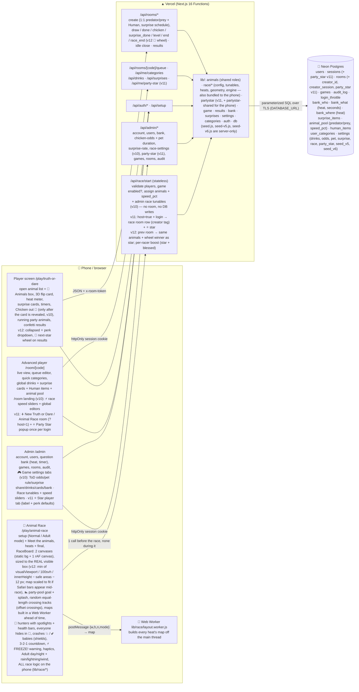
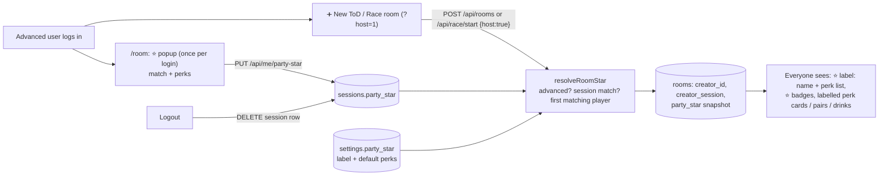
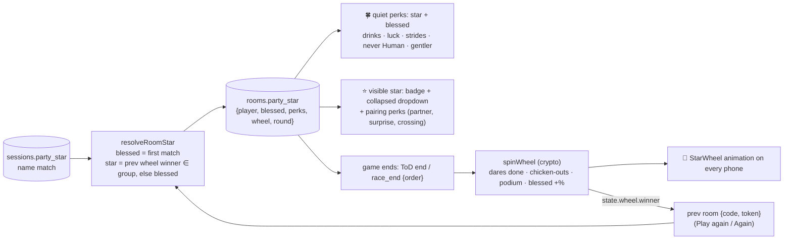
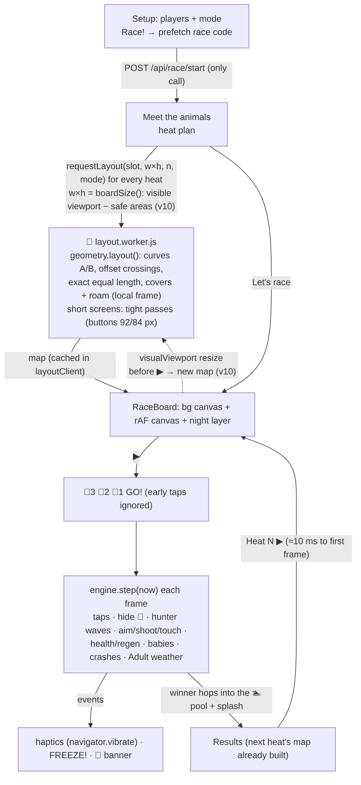

# Architecture

**Party Animal** (repo/project `party-games`) is a single **Next.js 16 (App Router)** app on **Vercel**. The pages run in the
phone's browser, the API runs as Vercel Functions (Node.js), and all state lives in
**Postgres (Neon, via the Vercel Marketplace)**. Nothing secret is stored in the repo.



## Directory tree

```
party-games/
├── app/                              ── UI pages (browser) + API routes (server)
│   ├── layout.js                     Site shell + "Party Animal" title/metadata/brand; Login button (AuthButton.js)
│   ├── page.js                       Home ("Party Animal"): game tiles, hides games disabled by the admin
│   ├── globals.css                   Neon/dark mobile-first styles (+ gender dots, chicken modal, animals)
│   ├── play/truth-or-dare/page.js    PLAYER SCREEN (v9: Results / Timer / Confetti / SurpriseBody lazy, prefetched at game start): names + Male/Female, level, room code, OPEN animal list after
│   │                                 Start (name, gender dot, emoji, animal, Predator/Prey/Human) + collapsible
│   │                                 🐾 Animals box (native <details>, no server call), heat meter, virus banner,
│   │                                 3D flip card (Truth cyan / Dare pink / Surprise amber, shimmer while the
│   │                                 single draw request is in flight), timers, Chicken out 🐔, running animals =
│   │                                 the players' own animals (Human = 🏃), "🧍 Human card" label,
│   │                                 End game, results + confetti
│   │                                 v11: ?host=1 → host note; ⭐ start announcement, ⭐ badges, ⭐ in score chips,
│   │                                 "⭐ <label>’s pick 💕" on perk cards / surprise pairs, drink-odds/luck tag on chicken
│   │                                 v12: per-card star labels removed; collapsed ⭐ dropdown at the bottom (start + play);
│   │                                 🎡 StarWheel on the results; Play again sends prev {code, token} → wheel winner = star
│   ├── play/animal-race/page.js      🏁 ANIMAL RACE: setup (shared PlayerRows) → Meet the animals (shared
│   │                                 AnimalList + heat plan chips) → heats → final → champion; remembers players.
│   │                                 v9: RaceBoard / RaceResults / Confetti via next/dynamic, prefetched on "Race!";
│   │                                 every heat's map requested from the Web Worker during meet/results (instant next heat)
│   │                                 v11: ?host=1 → race room (ended at the champion); ⭐ announcement + badges; crossing
│   │                                 partner swapped into the star's heat (plan.pair → RaceBoard); ⭐ on results + champion
│   │                                 v12: champion → race_end {order} → 🎡 wheel; "Again" (hosted) → /api/race/start with prev
│   │                                 (same animals, new star); racers carry boost (star + blessed); no crossing label
│   ├── login/page.js                 Login form (advanced players + admins)
│   ├── setup/page.js                 One-time first-admin form (needs ADMIN_SETUP_SECRET)
│   ├── room/page.js                  Enter a room code; v10: advanced users land here → ⚡ race speed sliders +
│   │                                 global surprise/pool editor (lazy, signed-in advanced/admin only)
│   │                                 v11: ➕ CREATE ROOM tiles (Truth or Dare / Animal Race via ?host=1) next to the
│   │                                 room-code form; ⭐ Party Star status line + PartyStarPopup (once per login session)
│   ├── room/[code]/page.js           ADVANCED: live view + queue editor (components/QueueEditor.js; its Category /
│   │                                 Drinks / Surprise editors load lazily)
│   ├── admin/page.js                 ADMIN PAGE: my account, users (create/enable/reset/delete), question
│   │                                 bank, chicken odds + hidden rule, drinks, games, live rooms, audit
│   │                                 (v9: Bank / Odds / Drinks / Surprise / Surprise-rate panels lazy-loaded)
│   └── api/
│       ├── games/route.js            GET enabled games (public)
│       ├── admin/race-settings/route.js  v10 ADMIN: GET/PUT Animal Race tunables (validated; overrides only)
│       ├── admin/party-star/route.js v11 ADMIN: GET/PUT ⭐ role label + default perks ({reset:true} → built-in defaults)
│       ├── me/party-star/route.js    v11 ADVANCED: GET/PUT this login session's Party Star match + perks (sessions.party_star)
│       ├── race/start/route.js       ANIMAL RACE START (POST; stateless unless v11 host=true + login → race room + creator tag + ⭐ star, never Human): game enabled? players valid? → animals
│       │                             (1:1 predator/prey + Human) with speed_pct (v9: no wild list)
│       ├── rooms/route.js            POST create room (players with gender) → code + host token + public animals
│       │                             v11: host=true (advanced login) → creator tag + ⭐ star snapshot on the room
│       ├── rooms/[code]/route.js     GET public room state (no odds / rule ever exposed)
│       ├── rooms/[code]/action/route.js  POST draw | done | chicken {petted:[{id,elapsedMs}]} | surprise_done | level | end
│       │                                 (host token; response = new state, no history → no refetch)
│       ├── rooms/[code]/queue/route.js   GET/PUT hidden question queues (advanced/admin)
│       ├── me/categories/…           QUICK CATEGORIES: GET/POST, PATCH/DELETE [id] (own only)
│       ├── config/route.js           GET public UI config (petted duration seconds)
│       ├── drinks/route.js           DRINK OPTIONS: GET/PUT global chicken-out drinks (advanced/admin)
│       ├── surprises/route.js        SURPRISE CONTENT + ANIMAL POOL + HUMAN ITEMS: GET all / POST surprise,
│       │                             {kind:'animal', role} or {kind:'human', humanKind} (advanced/admin, GLOBAL)
│       ├── surprises/[id]/route.js   PATCH / DELETE a surprise (sp-…), pool animal (an-…, min 8 per side) or Human item (hu-…)
│       ├── auth/login|logout|me/route.js  Session login/logout/current user
│       ├── setup/route.js            One-time admin bootstrap (refuses once an admin exists)
│       └── admin/
│           ├── account/route.js      POST change own username and/or password (current password required)
│           ├── users/route.js        GET list / POST create advanced user
│           ├── users/[id]/route.js   PATCH enable/disable · DELETE advanced user (cascades sessions+categories)
│           ├── users/[id]/password/route.js  POST reset password (revokes sessions)
│           ├── bank/route.js         QUESTION BANK: GET all / POST add WHO|WHAT|WHERE
│           ├── bank/[kind]/[id]/route.js  PATCH edit / DELETE bank entry
│           ├── chicken-odds/route.js ANIMAL RULE: GET/PUT odds, hidden rule (target any-prey | any-predator | human |
│           │                         pool animal id), petted duration (3-300 s); GET returns the target list
│           ├── surprise-rate/route.js SURPRISE SHARE: GET/PUT surprise cards as % of total questions (admin, 0-50, default 10)
│           ├── games/route.js        GET/PATCH home-page game toggles
│           ├── rooms/route.js        GET live rooms (last 12h)
│           └── audit/route.js        GET last 100 audit entries
├── components/
│   ├── AuthButton.js                 Login / user menu (top-right)
│   ├── QueueEditor.js                Drag-and-drop WHO/WHAT/WHERE editor + category filter
│   ├── CategoryManager.js            Add/edit/delete own quick categories
│   ├── DrinksEditor.js               Global chicken-out drink options
│   ├── GenderDot.js                  Blue (male) / pink (female) solid circle next to names
│   ├── Results.js                    End-of-game results (awards, titles, pairs) for players + advanced view
│   ├── RunningAnimals.js             CSS-animated animals (in a game: the players' animals, up to 16 lanes; setup:
│   │                                 generic babies); tap = petted 20 s (reduced-motion aware); they run
│   │                                 BEHIND the UI (z-index -1) so they never block a button but stay tappable
│   ├── RaceSpeedEditor.js            v10: ⚡ per-animal race speed range sliders (80–120 %, value shown, debounced
│   │                                 global save; server clamps). Used on /room, in SurpriseEditor, admin Race tab
│   ├── SurpriseEditor.js             Surprise cards (type/level/text/on-off/timer), 🧍 Human tab (surprise/truth/
│   │                                 dare) + predator/prey animal pool
│   │                                 (advanced room view + admin page; loads only when opened);
│   │                                 pool chips: tap → edit name/emoji + ⚡ race speed 80–120% (⚡N% tag)
│   ├── party/store.js                SHARED setup: remembered players (localStorage key shared by both games),
│   │                                 min/max, blank row, checkPlayers
│   ├── party/PlayerRows.js           SHARED name + Male/Female rows + add/remove (Truth or Dare + Animal Race)
│   ├── party/useNoSelect.js          NO SELECTABLE TEXT in both games (every phase): html.no-select class
│   │                                 (user-select none, -webkit-touch-callout none) + blocks contextmenu /
│   │                                 selectstart / dragstart except inside inputs (player names still editable)
│   ├── party/AnimalList.js           SHARED "Meet the animals" list (name, gender dot, emoji, Predator/Prey/Human)
│   ├── party/StarBadge.js            v11 "⭐ <label>" badge (animal lists, race lane/results, champion)
│   ├── party/StarAnnounce.js         v12 COLLAPSED <details> dropdown "⭐ <label>: <name> ▸" → plain perk list (start/play/race screens)
│   ├── party/StarWheel.js            v12 🎡 next-star wheel: one SVG + one CSS transform (server already picked the winner)
│   ├── PartyStarPopup.js             v11 once-per-login popup: name match (contains, case-insensitive) + session perks
│   ├── StarPerksForm.js              v11 shared perk toggles + values (admin card + session popup)
│   ├── admin/PartyStarPanel.js       v11 Admin → Game settings → ⭐ Star player: label rename + default perks + v12 🎡 wheel weights
│   ├── race/RaceBoard.js             RACE BOARD (v9 canvas; ⭐ lane name, crossing pair (no label); v12 per-racer boost, .race-stage map layer scaled to fit the visible box on any viewport change): static background canvas (tracks, puddles, goal; drawn
│   │                                 once) + ONE dynamic canvas redrawn per rAF (racers, 🌿 bush over every hidden
│   │                                 racer, health bars below full, babies trailing their parent + 💨 poof, 🤠🔫
│   │                                 hunters + spotlight cones (night: long glowing cut-outs on the low-res night
│   │                                 layer), red laser sight, tracer + muzzle flash + impact, shaking cover before a
│   │                                 wave, 💥/💕 fx, rain/wind/lightning). DOM only for the tap buttons, big 🐢3 🐇2
│   │                                 🐆1 GO! countdown (early taps ignored), ⚡ FREEZE! overlay + tint, 🤠 banner,
│   │                                 finish label. Haptics via navigator.vibrate (tap tick throttled, hit, death,
│   │                                 finish, GO, freeze; silent on iOS). Gets its map from layoutClient (worker).
│   │                                 Test hooks: window.__race, __layoutMs, __heatFrameAt
│   │                                 v10: 🏊 PARTY POOL goal drawn once in the bg canvas (deck, water, floats) + 1
│   │                                 ripple ring/frame; winner hops in with a splash. Admin tunables via `tune` prop.
│   │                                 Re-maps on visualViewport resize before ▶; button size from lay.bR
│   ├── race/RaceResults.js           Heat/final podium (medals, distance bars) + 🍺 Drink! callout for last place; v11 ⭐ badge
│   ├── play/Timer.js                 Countdown (Start/Pause + Reset), runs only on the phone
│   ├── play/Confetti.js              Hand-rolled CSS confetti (36 spans, after first paint, reduced-motion off)
│   ├── play/SurpriseBody.js          Surprise face: Animal Match (predator + prey, with player names), Human,
│   │                                 Virus, Group vote (1-2-3), Whisper (peek), Chooser
│   ├── play/Chooser.js               Dare Chooser: multi-touch finger pick + tap-to-join fallback
│   ├── admin/AccountPanel.js         Change own username / password
│   ├── admin/BankPanel.js            Manage WHO / WHAT (+ heat 1-3, timer seconds) / WHERE (+ heat) bank
│   ├── admin/SurpriseRatePanel.js    Surprise cards as a share of total questions (admin only)
│   ├── admin/GameSettings.js         v10: "🎮 Game settings" — a tab per game (ToD: odds + pet rule, surprise share,
│   │                                 drinks, surprise cards, bank · Race: tunables + speeds); only the open tab loads
│   ├── admin/RaceSettingsPanel.js    v10: race tunables form (save / reset to defaults)
│   ├── admin/OddsPanel.js            Chicken odds + hidden rule (pet-rule target select)
│   └── api.js                        fetch helper
├── lib/                              ── server-side logic
│   ├── partystar.js                  SERVER: settings `party_star` {label, perks, wheel}, session match, resolveRoomStar (v12: blessed + star),
│   │                                 v12: loadPrevRoom (own room, same session, token), hasQuiet, spinWheel (crypto), publicWheel
│   │                                 (host + advanced/admin + session match → first matching player), publicStar
│   ├── partystar-shared.js           SHARED (server + phone; v12 PAIR_PERKS, WHEEL_DEFAULTS/FIELDS, cleanWheel, wheelSlices, pickSlice): defaults, field ranges, cleanPerks/cleanLabel/cleanMatch,
│   │                                 matchStar (contains, first match), perkList (plain text announced to everyone)
│   ├── content.js                    CLIENT-SAFE constants only (levels, private-part blocklist, running
│   │                                 animals, pet-duration limits, drink categories, default drinks/odds)
│   ├── seed.js                       SERVER-ONLY first-run bank seed (WHO, WHERE incl. thigh, WHAT templates,
│   │                                 "Flirty default" category); moved out of content.js to shrink phone JS
│   ├── seed-v5.js                    SERVER-ONLY v5 seed: 40 Adult items, pick-a-partner + two-player dares,
│   │                                 timed items, surprise cards for every type × level, female/male decks,
│   │                                 one-time heat/seconds guesses for existing rows
│   ├── seed-v6.js                    SERVER-ONLY v6 seed: 20-animal pool (10 predators / 10 prey), predator-plays-
│   │                                 with-prey Animal Match texts, v5→v6 match rewrites, Human surprise/truth/dare
│   ├── bank.js                       QUESTION BANK (DB): load (10 s per-instance cache, invalidated on writes;
│   │                                 also carries enabled Human truth/dare items)
│   │                                 + validated CRUD for bank_who/what/where incl. heat + seconds; {partner}
│   ├── settings.js                   SETTINGS: drink options, odds + pet-rule target (ruleHit), petted duration,
│   │                                 surprise share (settings table); server-side drink pick + petted-window check
│   ├── surprises.js                  SURPRISE CONTENT + ANIMAL POOL + HUMAN ITEMS (surprise_items, animal_pool,
│   │                                 human_items): validated CRUD; atomic "keep ≥ 8 per side" delete
│   ├── categories.js                 QUICK CATEGORIES (user_categories table), per-user seeding
│   ├── game.js                       ROOM/QUEUE LOGIC: codes, genders, queues (players × 10, heat-ordered mild →
│   │                                 hot + jitter), question budget, turns, draw/done/chicken/surprise_done/level/
│   │                                 end, surprise schedule fixed at Start + 3-turn virus, 1:1 predator/prey
│   │                                 assignment (+ Human on odd counts), Human Truth/Dare draws (1 in 3),
│   │                                 idle close (inside the action transaction), per-turn stats
│   │                                 v11: createRaceRoom, creator tag, ⭐ star partner cards (opposite sex, ≥ partnerMinSec,
│   │                                 {who}/{partner}), star drink odds + luck re-roll, surprise partner pick, all labelled
│   │                                 v12: quiet drinks/luck for star OR blessed; pairing only for the star; endRoom spins the
│   │                                 ToD wheel (daresDone / chicken); race_end action (podium → wheel); publicRoom.wheel
│   ├── results.js                    STATS/RESULTS LOGIC: state.stats shape, awards, ties, funny titles, pairs
│   ├── auth.js                       SESSION/AUTH LOGIC: Argon2id, login + lockout, IP throttling,
│   │                                 session tokens (SHA-256 in DB), roles, audit log
│   │                                 v11: getUser also returns sessions.party_star (session_star); logout deletes it
│   ├── db.js                         DATABASE SCHEMA + idempotent additive migrations + first-run seeding +
│   │                                 one-time `seed_v5` / `seed_v6` (inserts only missing rows; never wipes edits)
│   │                                 v11 additive: sessions.party_star, rooms.creator_id / creator_session / party_star
│   ├── animals.js                    SHARED ANIMAL ROLES: shuffle, 1:1 predator/prey + 🧍 Human on odd counts,
│   │                                 public animal view (used by game.js and the race start API)
│   ├── race/tunables.js              v10: the admin-tunable race numbers (defaults = config.js), validate / clean /
│   │                                 applyTunables(cfg, tune) — shared by server + phone
│   ├── race/config.js                🏁 RACE TUNABLES (ONE file, every number): steps, tap cap, track length
│   │                                 factor/samples/crossing zone, crossing offset (crossShift, crossOffsetPx 34,
│   │                                 layoutBudgetMs), crash distance + love cooldown, covers + roam, HUNTERS
│   │                                 (first 1.5 s, every 7 s / Adult 6 s, max 2 / Adult 3 per track, cone 30°
│   │                                 125 px / night 175 px, aim 650 ms, shot gap, touch 34 px), HEALTH (100,
│   │                                 55 → 34 damage by distance, regen 7/s after 1.8 s), babies (cap 6, 20 px
│   │                                 gap, poof), countdown animals, haptics patterns, penalty 900+1000+700 ms,
│   │                                 speed clamp 80–120, `adult` (90 steps, longer tracks, weather, 1.7 s
│   │                                 lightning warning); modeCfg(mode), clampSpeed()
│   ├── race/heats.js                 Heat sizes (≤4, balanced) + predator/prey mixing; final when >1 heat
│   ├── race/geometry.js              RANDOM CURVY TRACKS (v9): TWO sine-series curves A and B of EXACTLY the same
│   │                                 length (polished on the 240-point resample to ~1e-12 px). A passes crossing
│   │                                 point P1 shifted 38-66 px off the centre line, B its mirror image → bl = A,
│   │                                 br = B mirrored, tl = B mirrored, tr = A mirrored: crossings stay exact but
│   │                                 are reached at different progress (≥ 34 px), and racers at the same progress
│   │                                 are never within crash distance. Time budget, then a symmetric (v8-style)
│   │                                 fallback. Keep-off grid; covers + roam points in each track's LOCAL frame
│   │                                 (same progress / side / distance), mirrored; landscape = rotated portrait
│   ├── race/layout.worker.js         Web Worker: builds a map (layout()) off the main thread
│   ├── race/layoutClient.js          v12 visibleBox()/syncViewport() → --rb-top/left/w/h px (iPhone Safari bars); Worker client + cache (slot|w×h|n|mode → Promise<map>); main-thread idle
│   │                                 fallback only if Workers are unavailable
│   │                                 v10: boardSize() measures an invisible .race-board probe (visible viewport via
│   │                                 --vvh / 100dvh minus env(safe-area-inset-*)); syncViewport() sets --vvh
│   ├── race/engine.js                Pure race state machine (v12: per-racer boost {tap, gentle, luck} for star + blessed; hunter looks away quietly): taps × speed, idle = hidden in a bush (every role),
│   │                                 racer crashes (predator/prey → both home; same role + opposite gender → 💕
│   │                                 BOTH get a baby, 10 s cooldown; else pass; Human passes), HUNTER waves (same
│   │                                 times for every track; each hunter hunts only its own track's racer):
│   │                                 emerge → wander → spot a MOVING racer in the cone → aim → shoot (damage by
│   │                                 distance; a baby absorbs a shot) → stalk; touch = instant kill; hiding drops
│   │                                 the target; health + regen; death = start + 2600 ms + full health; Adult
│   │                                 weather timeline; ranking + drinkers (unit-tested in node)
│   ├── games.js                      Home-page game slots registry (add new games here; Animal Race = slot 2)
│   └── http.js                       JSON responses, Origin (CSRF) check, input validation, errors
├── next.config.mjs                   Security headers (HSTS, nosniff, frame deny, …)
├── .env.example                      Names of required env vars (no real values)
├── ARCHITECTURE.md                   This file
└── README.md
```

## Where things live

| Thing | Location |
|---|---|
| Question bank (live) | Postgres `bank_who`, `bank_what` (+ `heat` 1-3, `seconds`), `bank_where` (+ `heat`) (edited on /admin; seeded once from `lib/seed.js` + `lib/seed-v5.js`) |
| Surprise cards | `surprise_items` table (type match/virus/vote/whisper/chooser, level, text, enabled, seconds); GLOBAL, edited by advanced players + admins |
| **Animal pool (v6)** | `animal_pool` table (id `an-…`, role predator/prey, name, emoji, sort, **`speed_pct` INT default 100 (v8, 80–120, server-clamped)**); 10 + 10 seeded; GLOBAL, edited by advanced players + admins; deletes blocked below 8 per side. (The v5 `animal_deck` table is kept but unused.) |
| **Human items (v6)** | `human_items` table (id `hu-…`, kind surprise/truth/dare, level, text, enabled, seconds); GLOBAL, same editors |
| Animals per room | `rooms.state.animals` (player → {id, role predator/prey/human, name, emoji}); PUBLIC in the room state, shown on the reveal list, the 🐾 Animals box, the running animals and results |
| Surprise share | `settings` row `surprise` = `{rate}` = % of total questions (admin only, 0-50, default 10 → 1 per 10 questions) |
| Surprise schedule per room | `rooms.state.surpriseAt` (finished-turn numbers, fixed at Start, never sent to the phone) + `state.turnsDone` |
| Open surprise / virus | `rooms.state.surprise` (`pair` = [predator player, prey player] for Animal Match), `rooms.state.virus` `{text, turnsLeft}` |
| Seed markers | `settings` rows `seed_v5`, `seed_v6` (each one-time; deleted items are not re-added; v6 rewrote only unchanged v5 match texts and switched the pet rule 'kitten' → 'any-prey' only if it was still the default) |
| Quick categories | `user_categories` table (one row per category, per user; `who_rule`, `what_ids`, `where_list`) |
| Chicken-out drink options | `settings` row `drinks` (global; edited by advanced players and admins) |
| Chicken odds + hidden animal rule | `settings` row `odds` (admin only; `rule.animal` = any-prey (default) / any-predator / human / pool id; outcome picked server-side in `lib/settings.js`) |
| Player genders | `rooms.genders` JSONB (name → male/female) |
| Petted duration (= secret-rule window) | `settings` row `pet` = `{seconds}` (default 20, 3-300) |
| Room lifecycle | `rooms.status` (active / ended / closed), `closed_reason` (complete / host / idle), `ended_at`, `last_activity` (last Truth/Dare pick) |
| Per-turn stats | `rooms.state.stats` (per player: truths, dares, done, chicken, drinks by category; pair interaction counts) + `rooms.history` (each turn with resolved WHO `target`, result, drink) |
| Account + password schema | `users` table in `lib/db.js` (`password_hash` = Argon2id) |
| **Passwords** | Only as Argon2id hashes in the Postgres `users` table. There is no password file in the repo. |
| Sessions | `sessions` table: SHA-256 of a random 256-bit token; the raw token is only in an httpOnly cookie `pg_session` (Secure, SameSite=Lax, 12h) |
| Rooms, queues, history | `rooms` table (`truth_queue`, `dare_queue`, `history`, `state` as JSONB) |
| Game on/off switches | `games` table (missing row = enabled); `animal-race` uses the same switch |
| **Animal Race rules + timing (v9)** | `lib/race/config.js` (`RACE`): stepsToGoal 45 (Adult 90), stopMs 350, maxTapsPerSec 14, track length 1.5× straight (Adult 1.85×), crossOffsetPx 34, crashDist 22, loveCooldownMs 10000, covers 2 per track (Adult 3), hunters 1.5 s + every 7 s (Adult 6 s) up to 2 (Adult 3) per track, cone 30° / 125 px (night 175 px), aim 650 ms, touch 34 px, health 100 / damage 55→34 / regen 7 per s after 1.8 s, maxBabies 6, penalty 900 + 1000 + 700 = 2600 ms for every death, haptics, `adult.*` weather numbers. Code constants; v10: hunter wave timing (first + every, Normal/Adult), shot damage close/far and the three penalty phases are admin-tunable (`settings.race` = overrides only, `lib/race/tunables.js`, defaults identical) |
| **Per-animal race speed (v8)** | `animal_pool.speed_pct` (advanced players + admins: v10 range sliders 80–120 % in `components/RaceSpeedEditor.js` on /room, the room pool editor and Admin → Game settings → Animal Race; clamped server-side); sent by `/api/race/start` for racers; distance per tap × speed/100 (hunters are the same for everyone) |
| **Race mode** | localStorage `partygames.race.mode` (normal / adult), picked on the race setup screen |
| **Animal Race state** | Only in the phone's memory during a race (no room, no DB row, nothing sent to the server); players remembered in localStorage `partygames.tod.players.v3` (shared with Truth or Dare) |
| Animal Race animals | Same `animal_pool` table; roles dealt by `lib/animals.js` |
| **⭐ Party Star (v11)** | Global label + default perks: `settings.party_star` (Admin → Game settings → ⭐ Star player). Session match + perks: `sessions.party_star` (deleted with the session at logout). Per-room snapshot: `rooms.party_star` + `rooms.creator_id` / `creator_session`. Logic: `lib/partystar.js`, `lib/partystar-shared.js`, `lib/game.js`, `app/api/race/start`, `lib/race/engine.js`, `components/race/RaceBoard.js` |
| **🍀 Blessed + 🎡 wheel (v12)** | Blessed = first player matching the session name (`rooms.party_star.blessed`, never public): quiet drinks/luck/race perks. Star = `rooms.party_star.player` (game 1 = blessed; then the previous room's `state.wheel.winner`). Wheel weights: `settings.party_star.wheel` (Admin → ⭐ Star player). Spin: `lib/partystar.js` spinWheel at ToD end / race `race_end`; shown by `components/party/StarWheel.js` |
| Audit trail | `audit_log` table (who, action, target, IP, time) |
| Login rate limiting | `login_throttle` table (per IP) + `users.failed_attempts` / `locked_until` (5 fails → 15 min lock) |

## Environment variables (Vercel project settings only)

| Name | Purpose |
|---|---|
| `DATABASE_URL` | Neon Postgres connection string (pooled), added by the Neon Marketplace integration `party-games-db`. Fallbacks if renamed: `POSTGRES_URL`, `POSTGRES_PRISMA_URL`, `DATABASE_URL_UNPOOLED`, `POSTGRES_URL_NON_POOLING` |
| `PGHOST`, `PGHOST_UNPOOLED`, `POSTGRES_USER`, `POSTGRES_PASSWORD` | Also added by Neon; not used by the app directly |
| `ADMIN_SETUP_SECRET` | Long random secret required by `/api/setup` to create the first admin (one time) |

## Request flow

1. **Player** (no login): picks a game → enters names + level → `POST /api/rooms`. The server makes a
   5-character room code, a random host token (only its hash is stored), and hidden queues of upcoming
   Truth and Dare questions (WHO + WHAT, plus WHERE for Adult touch dares).
2. Each Truth/Dare press calls `POST /api/rooms/[code]/action` → the server serves the **next item of that type
   from the current queue**, so edits made by an advanced player apply on the very next question.
3. **Advanced player / admin** logs in → opens `/room/[code]` → sees the live turn, card and history (polled every
   3 s) and drags WHO/WHAT/WHERE chips or whole questions; every change is saved with `PUT /api/rooms/[code]/queue`
   (validated server-side, audit-logged).
4. **Chicken out 🐔**: the player screen sends `{action:'chicken', petted:[animal ids]}`; the server picks the drink
   category with the configured odds (switching to the rule odds only if the target animal was petted less than the
   configured petted duration ago, + 2 s tolerance; the client sends elapsed ms, so device clocks don't matter) and a random
   option text. Only the result comes back; odds and the rule are never sent to players.
5. **Questions per room** = players × 10. Each queue (truth, dare) is built with that many items on creation and on a
   level change; the game ends automatically once that many questions have been played, or when the host taps End game.
6. **Idle timeout**: room reads/polls run `closeIfIdle`; player actions check `last_activity` inside their own
   transaction (one fewer round trip per tap). The admin live-rooms list closes all idle rooms. No cron.
7. **Results** are computed from `state.stats` (`lib/results.js`) whenever a room is not active, and shown to the
   player device and in the advanced room view.
8. **Admin** manages own account, advanced users, the question bank, odds/rule, games and live rooms at `/admin`.
9. **Instant feel (v5)**: a Truth/Dare tap flips the card in the same frame and sends ONE draw request; the face shows
   a shimmer until the response arrives (no prefetch, no cached cards; the server queue stays the source of truth).
   Next / Chicken / surprise Done flip back immediately. Every action button is disabled while its request is in
   flight (double-tap guard), and the action response is the new state (no refetch except after a 409).
10. **Surprises (v6)**: at Start the server fixes `count = round(total × share%)` (min 1 when share > 0) and picks one
   random finished-turn slot per equal stretch of turns 1 … total-1 (`state.surpriseAt`): never before the first
   question, never two in a row. When a slot is reached it picks a type among the enabled surprise items for the
   level (+ `human` items when the game has a Human). A surprise is its own turn (`surprise_done`), consumes no queue
   question and does not count toward players × 10. Animal Match always calls one PREDATOR ({a}) and one PREY ({b}),
   shown with player names. Virus sets a rule shown for the next 3 turns.
11. **Party animals (v6)**: at Start the players are shuffled; on an odd count one becomes the 🧍 Human; the rest
   split half predators / half prey (gender ignored) with unique pool animals. On about 1 in 3 of the Human's own
   Truth/Dare picks (`HUMAN_SHARE_DEN` in `lib/game.js`) a Human item is served instead of the queue head: the queue
   is not consumed or reordered, but the card counts toward players × 10. Chicken-out's hidden rule resolves petted
   running-animal ids through the room's animal roles (any-prey / any-predator / human / a specific animal).
12. **Heat (v5)**: new queues are sorted by WHAT heat (+ WHERE heat) with random jitter (initial order only); the heat
   meter shows turns played / total.

13. **Animal Race (v7)**: setup → `POST /api/race/start` (stateless; 403 when the admin disabled the game) →
   Meet the animals → heats of ≤4 (balanced, predators and prey mixed) → a final for heat winners when there is more
   than one heat. During a race everything runs on the phone: a tap moves the animal one step; with no tap for
   350 ms EVERY racer (predator, prey, Human) hides in a bush and is safe. Hunters 🤠 arrive at the same
   moments for every track (cue + shaking bush first), wander near their tree/bush, and shoot only a MOVING
   racer inside their spotlight (red laser first); 2-3 shots (closer = more damage) or a touch kills: back to the
   start after 2600 ms with full health. Health regenerates slowly. First to the goal wins; the rest rank by
   distance; last place (ties too) drinks.

14. **Animal Race (v9)**: every race gets new random curvy tracks, all exactly the same length and each crossing
   another; the crossings are offset so racers tapping at the same pace don't arrive together (crash sim at
   equal pace: 10.9 → ~0 meetings per race for 2/4 racers). Maps are built in a Web Worker while players look at
   the meet / results screens, so the next heat appears instantly. Racers meeting at a crossing (both moving):
   predator + prey → both go home (2600 ms); same role + opposite gender → 💕 and each gets a baby that follows
   it and absorbs one shot (max 6 per race), 10 s cooldown; otherwise (and always for the Human) they pass.
   Big 🐢3 🐇2 🐆1 GO! countdown (taps before GO ignored). Adult mode: longer tracks + a shared weather timeline
   — night (dark screen, light around racers, longer glowing spotlights), rain (puddles slide racers back; a big
   ⚡ FREEZE! warning with tint + vibration 1.7 s before the freeze; tapping in the freeze = same zap for anyone),
   wind (gusts push everyone back equally); tapping too fast at night or in rain trips the animal. Text in both
   games can't be selected or long-pressed (useNoSelect).

15. **⭐ Party Star (v11, visible to everyone)**: an advanced user (or admin) logs in → `/room` shows the popup once per
   login session (name contains …, case-insensitive; optional per-session perk tweaks) → `PUT /api/me/party-star` stores
   it in `sessions.party_star`. Rooms they create from `/room` (`?host=1` → `host:true`) get `creator_id` +
   `creator_session` and, when a player name matches, a snapshot `rooms.party_star = {player, gender, label, perks, list}`
   (first match only; later label/perk edits don't change running rooms). Logout deletes the session row → the setup is
   gone; a fresh login asks again. Everyone sees the start announcement "⭐ <label>: <name>" + the plain perk list, a ⭐
   badge (animal list, Animals box, race lane, results, champion), and a label on anything a perk produced ("⭐ <label>’s
   pick 💕", "⭐ <label>’s drink odds / luck"). Defaults (admin card; toggle + value each): chicken-out drinks 80/10/10
   water/sparkling/alcohol · 90 % of the star’s questions = partner card with an opposite-sex player, timer ≥ 15 s ·
   surprise pair cards 90 % opposite-sex partner · luck 70 % (ToD: an alcohol chicken-out drink is re-rolled to
   water/sparkling; Race: a hunter that spots the star looks away, ⭐ shown) · Race ×1.5 distance per tap · never the
   Human · 80 % an opposite-sex same-role racer joins the star's heat on a crossing track · hunters + weather 15 %
   gentler on the star’s track. Public / normal rooms are unchanged (no star).



16. **🍀 Blessed + 🎡 wheel (v12)**: the session name match is now the **blessed** player: quiet perks for the whole
   room (chicken-out drink odds, luck re-roll, race ×strides, never the Human, gentler hunters/weather), never named on
   screen (the race start response carries per-racer `boost` because the race runs on the phone). The **Party Star**
   (visible: ⭐ badge + collapsed perk dropdown) has ALL perks incl. the pairing perks (partner questions, surprise
   partner, race crossing partner); pairing perks only ever apply to the current star. Game 1: star = blessed. When a
   Party Star game ends (ToD end / race champion → `race_end {order}`), the server spins the wheel (crypto, weighted:
   ToD base + bonus for most dares DONE (rank 1-3), most chicken-outs × factor and always the smallest; Race base +
   podium bonus; blessed + %) and stores `state.wheel`; every phone animates the same result. "Play again"/"Again" in
   the same group sends `prev {code, token}` → the winner is the next star (falls back to the blessed player if the
   winner is not in the new group; a race replay keeps the animals). Per-card / race "⭐ pick" labels were removed.
17. **iPhone Safari bars (v12)**: the race board's box = min(visualViewport.height, 100svh, innerHeight, layout
   viewport) − safe areas − 12 px, written as px CSS variables; re-measured on visualViewport resize/scroll, resize and
   rotation. Before ▶ a changed size gets a new map; mid-race the map layer is scaled (transform) to fit, so the
   bottom tap buttons never slide under Safari's URL pill + toolbar.



### Animal Race (v9) on the phone



## Security summary

- Argon2id (m=19 MiB, t=2, p=1) password hashes; plaintext is never stored or logged.
- Random session tokens; only their SHA-256 is stored; httpOnly + Secure + SameSite=Lax cookies; 12 h expiry.
- Lockout after 5 failed logins (15 min) + per-IP throttle (20 failures / 15 min); constant-time handling of unknown users.
- CSRF: SameSite=Lax cookies + strict `Origin` check on every POST/PUT/PATCH.
- Role checks on every protected API route on the server; disabling a user or resetting a password deletes their sessions.
- Parameterized SQL only; all inputs validated (names, levels, queue items, WHERE limited to an allow-list).
- Admin account changes (username/password) require the current password; a password change signs out other sessions.
- First admin only via `ADMIN_SETUP_SECRET`, and only while no admin exists.
