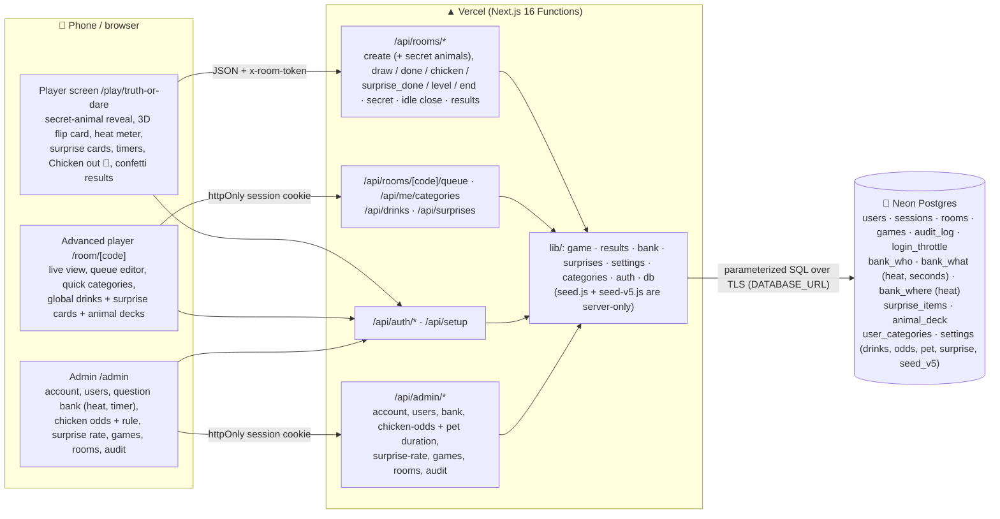

# Architecture

Party Games is a single **Next.js 16 (App Router)** app on **Vercel**. The pages run in the
phone's browser, the API runs as Vercel Functions (Node.js), and all state lives in
**Postgres (Neon, via the Vercel Marketplace)**. Nothing secret is stored in the repo.



## Directory tree

```
party-games/
├── app/                              ── UI pages (browser) + API routes (server)
│   ├── layout.js                     Site shell; Login button top-right (components/AuthButton.js)
│   ├── page.js                       Home: game tiles, hides games disabled by the admin
│   ├── globals.css                   Neon/dark mobile-first styles (+ gender dots, chicken modal, animals)
│   ├── play/truth-or-dare/page.js    PLAYER SCREEN: names + Male/Female, level, room code, secret-animal
│   │                                 pass-the-phone reveal (+ "🐾 My animal" re-peek), heat meter, virus banner,
│   │                                 3D flip card (Truth cyan / Dare pink / Surprise amber, shimmer while the
│   │                                 single draw request is in flight), timers, Chicken out 🐔, running animals,
│   │                                 End game, results + confetti
│   ├── login/page.js                 Login form (advanced players + admins)
│   ├── setup/page.js                 One-time first-admin form (needs ADMIN_SETUP_SECRET)
│   ├── room/page.js                  Enter a room code
│   ├── room/[code]/page.js           ADVANCED: live view + queue editor (components/QueueEditor.js)
│   ├── admin/page.js                 ADMIN PAGE: my account, users (create/enable/reset/delete), question
│   │                                 bank, chicken odds + hidden rule, drinks, games, live rooms, audit
│   └── api/
│       ├── games/route.js            GET enabled games (public)
│       ├── rooms/route.js            POST create room (players with gender) → code + host token
│       ├── rooms/[code]/route.js     GET public room state (no odds / rule ever exposed)
│       ├── rooms/[code]/action/route.js  POST draw | done | chicken {petted:[{id,elapsedMs}]} | surprise_done | level | end
│       │                                 (host token; response = new state, no history → no refetch)
│       ├── rooms/[code]/secret/route.js  GET the room's secret animals (host token only; used after a reload)
│       ├── rooms/[code]/queue/route.js   GET/PUT hidden question queues (advanced/admin)
│       ├── me/categories/…           QUICK CATEGORIES: GET/POST, PATCH/DELETE [id] (own only)
│       ├── config/route.js           GET public UI config (petted duration seconds)
│       ├── drinks/route.js           DRINK OPTIONS: GET/PUT global chicken-out drinks (advanced/admin)
│       ├── surprises/route.js        SURPRISE CONTENT + DECKS: GET all / POST surprise or {kind:'animal'} (advanced/admin, GLOBAL)
│       ├── surprises/[id]/route.js   PATCH / DELETE a surprise (sp-…) or a deck animal (deck-…)
│       ├── auth/login|logout|me/route.js  Session login/logout/current user
│       ├── setup/route.js            One-time admin bootstrap (refuses once an admin exists)
│       └── admin/
│           ├── account/route.js      POST change own username and/or password (current password required)
│           ├── users/route.js        GET list / POST create advanced user
│           ├── users/[id]/route.js   PATCH enable/disable · DELETE advanced user (cascades sessions+categories)
│           ├── users/[id]/password/route.js  POST reset password (revokes sessions)
│           ├── bank/route.js         QUESTION BANK: GET all / POST add WHO|WHAT|WHERE
│           ├── bank/[kind]/[id]/route.js  PATCH edit / DELETE bank entry
│           ├── chicken-odds/route.js ANIMAL RULE: GET/PUT odds, hidden rule, petted duration (3-300 s)
│           ├── surprise-rate/route.js SURPRISE RATE: GET/PUT % chance after each turn (admin only, 0-100, default 10)
│           ├── games/route.js        GET/PATCH home-page game toggles
│           ├── rooms/route.js        GET live rooms (last 12h)
│           └── audit/route.js        GET last 100 audit entries
├── components/
│   ├── AuthButton.js                 Login / user menu (top-right)
│   ├── QueueEditor.js                Drag-and-drop WHO/WHAT/WHERE editor + category filter
│   ├── CategoryManager.js            Add/edit/delete own quick categories
│   ├── DrinksEditor.js               Global chicken-out drink options
│   ├── GenderDot.js                  Blue (male) / pink (female) solid circle next to names
│   ├── Results.js                    End-of-game results (awards, titles, pairs) for players + advanced view
│   ├── RunningAnimals.js             CSS-animated baby animals; tap = petted 20 s (reduced-motion aware); they run
│   │                                 BEHIND the UI (z-index -1) so they never block a button but stay tappable
│   ├── SurpriseEditor.js             Surprise cards (type/level/text/on-off/timer) + female/male animal decks
│   │                                 (advanced room view + admin page; loads only when opened)
│   ├── play/Timer.js                 Countdown (Start/Pause + Reset), runs only on the phone
│   ├── play/Confetti.js              Hand-rolled CSS confetti (36 spans, after first paint, reduced-motion off)
│   ├── play/SurpriseBody.js          Surprise face: Animal Match, Virus, Group vote (1-2-3), Whisper (peek), Chooser
│   ├── play/Chooser.js               Dare Chooser: multi-touch finger pick + tap-to-join fallback
│   ├── admin/AccountPanel.js         Change own username / password
│   ├── admin/BankPanel.js            Manage WHO / WHAT (+ heat 1-3, timer seconds) / WHERE (+ heat) bank
│   ├── admin/SurpriseRatePanel.js    Surprise-card rate (admin only)
│   ├── admin/OddsPanel.js            Chicken odds + hidden rule settings
│   └── api.js                        fetch helper
├── lib/                              ── server-side logic
│   ├── content.js                    CLIENT-SAFE constants only (levels, private-part blocklist, running
│   │                                 animals, pet-duration limits, drink categories, default drinks/odds)
│   ├── seed.js                       SERVER-ONLY first-run bank seed (WHO, WHERE incl. thigh, WHAT templates,
│   │                                 "Flirty default" category); moved out of content.js to shrink phone JS
│   ├── seed-v5.js                    SERVER-ONLY v5 seed: 40 Adult items, pick-a-partner + two-player dares,
│   │                                 timed items, surprise cards for every type × level, female/male decks,
│   │                                 one-time heat/seconds guesses for existing rows
│   ├── bank.js                       QUESTION BANK (DB): load (10 s per-instance cache, invalidated on writes)
│   │                                 + validated CRUD for bank_who/what/where incl. heat + seconds; {partner}
│   ├── settings.js                   SETTINGS: drink options, odds + animal rule, petted duration, surprise
│   │                                 rate (settings table); server-side drink pick + petted-window check
│   ├── surprises.js                  SURPRISE CONTENT + ANIMAL DECKS (surprise_items, animal_deck): validated CRUD
│   ├── categories.js                 QUICK CATEGORIES (user_categories table), per-user seeding
│   ├── game.js                       ROOM/QUEUE LOGIC: codes, genders, queues (players × 10, heat-ordered mild →
│   │                                 hot + jitter), question budget, turns, draw/done/chicken/surprise_done/level/
│   │                                 end, server-rolled surprises + 3-turn virus, secret animal assignment,
│   │                                 idle close (inside the action transaction), per-turn stats
│   ├── results.js                    STATS/RESULTS LOGIC: state.stats shape, awards, ties, funny titles, pairs
│   ├── auth.js                       SESSION/AUTH LOGIC: Argon2id, login + lockout, IP throttling,
│   │                                 session tokens (SHA-256 in DB), roles, audit log
│   ├── db.js                         DATABASE SCHEMA + idempotent additive migrations + first-run seeding +
│   │                                 one-time `seed_v5` (inserts only missing rows; never wipes edits)
│   ├── games.js                      Home-page game slots registry (add new games here)
│   └── http.js                       JSON responses, Origin (CSRF) check, input validation, errors
├── next.config.mjs                   Security headers (HSTS, nosniff, frame deny, …)
├── .env.example                      Names of required env vars (no real values)
├── ARCHITECTURE.md                   This file
└── README.md
```

## Where things live

| Thing | Location |
|---|---|
| Question bank (live) | Postgres `bank_who`, `bank_what` (+ `heat` 1-3, `seconds`), `bank_where` (+ `heat`) (edited on /admin; seeded once from `lib/seed.js` + `lib/seed-v5.js`) |
| Surprise cards | `surprise_items` table (type match/virus/vote/whisper/chooser, level, text, enabled, seconds); GLOBAL, edited by advanced players + admins |
| Animal Match decks | `animal_deck` table (deck female/male, name, emoji); GLOBAL, edited by advanced players + admins |
| Secret animals per room | `rooms.state.animals` (player → deck, name, emoji); only sent to the host device (create response / `/secret`) and revealed in results |
| Surprise rate | `settings` row `surprise` = `{rate}` (admin only, default 10 %) |
| Open surprise / virus | `rooms.state.surprise` (Animal Match pair kept server-side only), `rooms.state.virus` `{text, turnsLeft}` |
| v5 seed marker | `settings` row `seed_v5` (the v5 inserts/heat guesses ran once; deleted items are not re-added) |
| Quick categories | `user_categories` table (one row per category, per user; `who_rule`, `what_ids`, `where_list`) |
| Chicken-out drink options | `settings` row `drinks` (global; edited by advanced players and admins) |
| Chicken odds + hidden animal rule | `settings` row `odds` (admin only; outcome picked server-side in `lib/settings.js`) |
| Player genders | `rooms.genders` JSONB (name → male/female) |
| Petted duration (= secret-rule window) | `settings` row `pet` = `{seconds}` (default 20, 3-300) |
| Room lifecycle | `rooms.status` (active / ended / closed), `closed_reason` (complete / host / idle), `ended_at`, `last_activity` (last Truth/Dare pick) |
| Per-turn stats | `rooms.state.stats` (per player: truths, dares, done, chicken, drinks by category; pair interaction counts) + `rooms.history` (each turn with resolved WHO `target`, result, drink) |
| Account + password schema | `users` table in `lib/db.js` (`password_hash` = Argon2id) |
| **Passwords** | Only as Argon2id hashes in the Postgres `users` table. There is no password file in the repo. |
| Sessions | `sessions` table: SHA-256 of a random 256-bit token; the raw token is only in an httpOnly cookie `pg_session` (Secure, SameSite=Lax, 12h) |
| Rooms, queues, history | `rooms` table (`truth_queue`, `dare_queue`, `history`, `state` as JSONB) |
| Game on/off switches | `games` table (missing row = enabled) |
| Audit trail | `audit_log` table (who, action, target, IP, time) |
| Login rate limiting | `login_throttle` table (per IP) + `users.failed_attempts` / `locked_until` (5 fails → 15 min lock) |

## Environment variables (Vercel project settings only)

| Name | Purpose |
|---|---|
| `DATABASE_URL` | Neon Postgres connection string (pooled), added by the Neon Marketplace integration `party-games-db`. Fallbacks if renamed: `POSTGRES_URL`, `POSTGRES_PRISMA_URL`, `DATABASE_URL_UNPOOLED`, `POSTGRES_URL_NON_POOLING` |
| `PGHOST`, `PGHOST_UNPOOLED`, `POSTGRES_USER`, `POSTGRES_PASSWORD` | Also added by Neon; not used by the app directly |
| `ADMIN_SETUP_SECRET` | Long random secret required by `/api/setup` to create the first admin (one time) |

## Request flow

1. **Player** (no login): picks a game → enters names + level → `POST /api/rooms`. The server makes a
   5-character room code, a random host token (only its hash is stored), and hidden queues of upcoming
   Truth and Dare questions (WHO + WHAT, plus WHERE for Adult touch dares).
2. Each Truth/Dare press calls `POST /api/rooms/[code]/action` → the server serves the **next item of that type
   from the current queue**, so edits made by an advanced player apply on the very next question.
3. **Advanced player / admin** logs in → opens `/room/[code]` → sees the live turn, card and history (polled every
   3 s) and drags WHO/WHAT/WHERE chips or whole questions; every change is saved with `PUT /api/rooms/[code]/queue`
   (validated server-side, audit-logged).
4. **Chicken out 🐔**: the player screen sends `{action:'chicken', petted:[animal ids]}`; the server picks the drink
   category with the configured odds (switching to the rule odds only if the target animal was petted less than the
   configured petted duration ago, + 2 s tolerance; the client sends elapsed ms, so device clocks don't matter) and a random
   option text. Only the result comes back; odds and the rule are never sent to players.
5. **Questions per room** = players × 10. Each queue (truth, dare) is built with that many items on creation and on a
   level change; the game ends automatically once that many questions have been played, or when the host taps End game.
6. **Idle timeout**: room reads/polls run `closeIfIdle`; player actions check `last_activity` inside their own
   transaction (one fewer round trip per tap). The admin live-rooms list closes all idle rooms. No cron.
7. **Results** are computed from `state.stats` (`lib/results.js`) whenever a room is not active, and shown to the
   player device and in the advanced room view.
8. **Admin** manages own account, advanced users, the question bank, odds/rule, games and live rooms at `/admin`.
9. **Instant feel (v5)**: a Truth/Dare tap flips the card in the same frame and sends ONE draw request; the face shows
   a shimmer until the response arrives (no prefetch, no cached cards; the server queue stays the source of truth).
   Next / Chicken / surprise Done flip back immediately. Every action button is disabled while its request is in
   flight (double-tap guard), and the action response is the new state (no refetch except after a 409).
10. **Surprises (v5)**: after each finished turn the server rolls `rate` %; if hit, it picks a type among the enabled
   surprise items for the level. A surprise is its own turn (`surprise_done`), consumes no queue question and does not
   count toward players × 10. Animal Match calls one female-deck + one male-deck secret animal (any two players in a
   single-gender group) and counts as a pair interaction. Virus sets a rule shown for the next 3 turns.
11. **Heat (v5)**: new queues are sorted by WHAT heat (+ WHERE heat) with random jitter (initial order only); the heat
   meter shows turns played / total.

## Security summary

- Argon2id (m=19 MiB, t=2, p=1) password hashes; plaintext is never stored or logged.
- Random session tokens; only their SHA-256 is stored; httpOnly + Secure + SameSite=Lax cookies; 12 h expiry.
- Lockout after 5 failed logins (15 min) + per-IP throttle (20 failures / 15 min); constant-time handling of unknown users.
- CSRF: SameSite=Lax cookies + strict `Origin` check on every POST/PUT/PATCH.
- Role checks on every protected API route on the server; disabling a user or resetting a password deletes their sessions.
- Parameterized SQL only; all inputs validated (names, levels, queue items, WHERE limited to an allow-list).
- Admin account changes (username/password) require the current password; a password change signs out other sessions.
- First admin only via `ADMIN_SETUP_SECRET`, and only while no admin exists.
