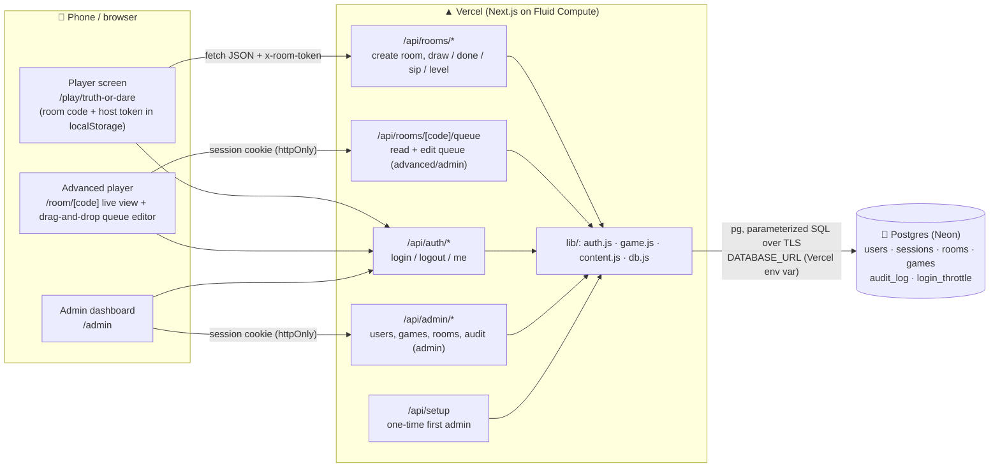

# Architecture

Party Games is a single **Next.js 16 (App Router)** app on **Vercel**. The pages run in the
phone's browser, the API runs as Vercel Functions (Node.js), and all state lives in
**Postgres (Neon, via the Vercel Marketplace)**. Nothing secret is stored in the repo.



## Directory tree

```
party-games/
├── app/                              ── UI pages (browser) + API routes (server)
│   ├── layout.js                     Site shell; Login button top-right (components/AuthButton.js)
│   ├── page.js                       Home: game tiles, hides games disabled by the admin
│   ├── globals.css                   Neon/dark mobile-first styles
│   ├── play/truth-or-dare/page.js    PLAYER SCREEN: names, level, room code, Truth/Dare, Next, drink
│   ├── login/page.js                 Login form (advanced players + admins)
│   ├── setup/page.js                 One-time first-admin form (needs ADMIN_SETUP_SECRET)
│   ├── room/page.js                  Enter a room code
│   ├── room/[code]/page.js           ADVANCED: live view + queue editor (components/QueueEditor.js)
│   ├── admin/page.js                 ADMIN PAGE: users, enable/disable games, live rooms, audit log
│   └── api/
│       ├── games/route.js            GET enabled games (public)
│       ├── rooms/route.js            POST create room → code + host token (public, rate limited)
│       ├── rooms/[code]/route.js     GET public room state (current player, card, history)
│       ├── rooms/[code]/action/route.js  POST draw | done | sip | level (host token required)
│       ├── rooms/[code]/queue/route.js   GET/PUT hidden question queues (advanced/admin)
│       ├── auth/login|logout|me/route.js  Session login/logout/current user
│       ├── setup/route.js            One-time admin bootstrap (refuses once an admin exists)
│       └── admin/
│           ├── users/route.js        GET list / POST create advanced user (admin)
│           ├── users/[id]/route.js   PATCH enable/disable (disable revokes sessions)
│           ├── users/[id]/password/route.js  POST reset password (revokes sessions)
│           ├── games/route.js        GET/PATCH home-page game toggles
│           ├── rooms/route.js        GET live rooms (last 12h)
│           └── audit/route.js        GET last 100 audit entries
├── components/
│   ├── AuthButton.js                 Login / user menu (top-right)
│   ├── QueueEditor.js                Drag-and-drop WHO/WHAT/WHERE editor (pointer events, touch-friendly)
│   └── api.js                        fetch helper
├── lib/                              ── server-side logic
│   ├── content.js                    QUESTION BANK: levels (Children/Teen/Adult), WHO targets,
│   │                                 WHERE body parts, WHAT templates (40 truths + 40 dares per level)
│   ├── game.js                       ROOM/QUEUE LOGIC: room codes, queue generation, turn rotation,
│   │                                 draw/done/sip/level, queue edit validation, live rooms
│   ├── auth.js                       SESSION/AUTH LOGIC: Argon2id hashing, login + lockout,
│   │                                 IP throttling, session tokens (SHA-256 in DB), roles, audit log
│   ├── db.js                         DATABASE SCHEMA (auto-created) + pg pool + transactions
│   ├── games.js                      Home-page game slots registry (add new games here)
│   └── http.js                       JSON responses, Origin (CSRF) check, input validation, errors
├── next.config.mjs                   Security headers (HSTS, nosniff, frame deny, …)
├── .env.example                      Names of required env vars (no real values)
├── ARCHITECTURE.md                   This file
└── README.md
```

## Where things live

| Thing | Location |
|---|---|
| Questions (WHAT templates, WHO targets, WHERE parts) | `lib/content.js` |
| Account + password schema | `users` table in `lib/db.js` (`password_hash` = Argon2id) |
| **Passwords** | Only as Argon2id hashes in the Postgres `users` table. There is no password file in the repo. |
| Sessions | `sessions` table: SHA-256 of a random 256-bit token; the raw token is only in an httpOnly cookie `pg_session` (Secure, SameSite=Lax, 12h) |
| Rooms, queues, history | `rooms` table (`truth_queue`, `dare_queue`, `history`, `state` as JSONB) |
| Game on/off switches | `games` table (missing row = enabled) |
| Audit trail | `audit_log` table (who, action, target, IP, time) |
| Login rate limiting | `login_throttle` table (per IP) + `users.failed_attempts` / `locked_until` (5 fails → 15 min lock) |

## Environment variables (Vercel project settings only)

| Name | Purpose |
|---|---|
| `DATABASE_URL` | Neon Postgres connection string, added by the Neon Marketplace integration |
| `ADMIN_SETUP_SECRET` | Long random secret required by `/api/setup` to create the first admin (one time) |

## Request flow

1. **Player** (no login): picks a game → enters names + level → `POST /api/rooms`. The server makes a
   5-character room code, a random host token (only its hash is stored), and hidden queues of upcoming
   Truth and Dare questions (WHO + WHAT, plus WHERE for Adult touch dares).
2. Each Truth/Dare press calls `POST /api/rooms/[code]/action` → the server serves the **next item of that type
   from the current queue**, so edits made by an advanced player apply on the very next question.
3. **Advanced player / admin** logs in → opens `/room/[code]` → sees the live turn, card and history (polled every
   3 s) and drags WHO/WHAT/WHERE chips or whole questions; every change is saved with `PUT /api/rooms/[code]/queue`
   (validated server-side, audit-logged).
4. **Admin** manages advanced users, toggles home-page games and sees live rooms at `/admin`.

## Security summary

- Argon2id (m=19 MiB, t=2, p=1) password hashes; plaintext is never stored or logged.
- Random session tokens; only their SHA-256 is stored; httpOnly + Secure + SameSite=Lax cookies; 12 h expiry.
- Lockout after 5 failed logins (15 min) + per-IP throttle (20 failures / 15 min); constant-time handling of unknown users.
- CSRF: SameSite=Lax cookies + strict `Origin` check on every POST/PUT/PATCH.
- Role checks on every protected API route on the server; disabling a user or resetting a password deletes their sessions.
- Parameterized SQL only; all inputs validated (names, levels, queue items, WHERE limited to an allow-list).
- First admin only via `ADMIN_SETUP_SECRET`, and only while no admin exists.
